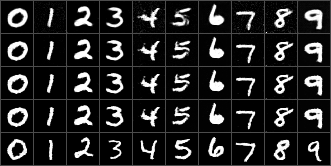
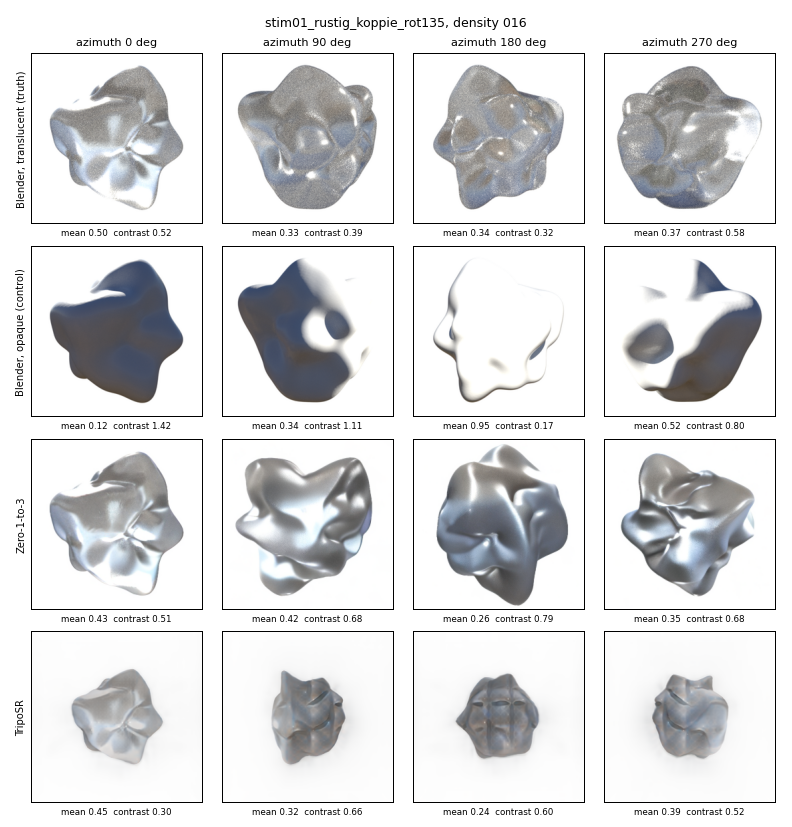
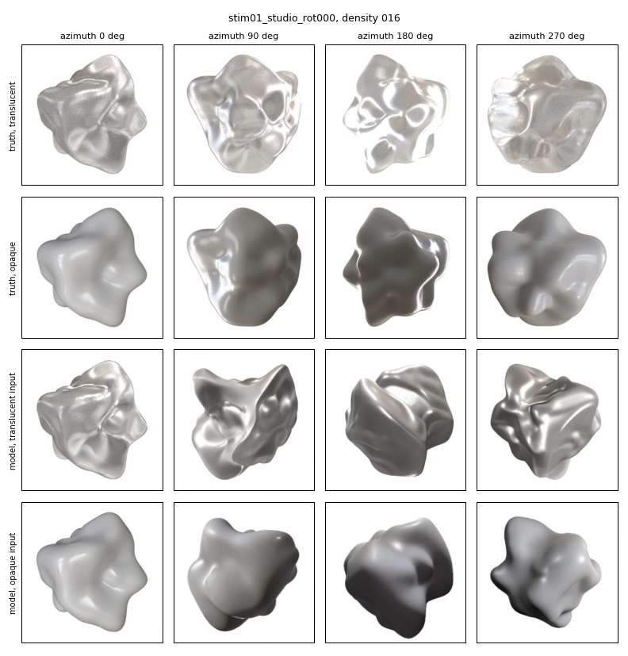

# Diffusion models and single-image 3D generation: do they keep translucency?

A learning repository with one experiment. The first half implements diffusion models from scratch
(DDPM, classifier-free guidance, DDIM). The second half takes two pretrained single-image-to-3D models and asks
a question from material perception: **when the input image shows a translucent object, what do these models
put on the side they cannot see?** The answer is checked against physically based renders of the true object
from the same viewpoints, and against an opaque control with the same shape and lighting.

Everything was run on a Quadro M4000 (8 GB, Maxwell generation).

## At a glance

- **Diffusion from scratch.** DDPM, class conditioning with classifier-free guidance, and a DDIM sampler, in
  about 300 lines of PyTorch. Trained on a 2D toy distribution and on MNIST.
- **Zero-1-to-3 sampling written by hand.** The conditioning (CLIP embedding + relative camera pose, input
  latent concatenated to the noisy latent) and the guidance loop are written directly on the pretrained
  weights, using the same pieces as the MNIST code.
- **An experiment with ground truth.** 6 shape-and-lighting conditions x 3 scattering densities. For each, the
  true novel views and an opaque control are path traced; Zero-1-to-3 (3 seeds) and TripoSR are run on the same
  input image.

| Result (unseen views: 90, 180, 270 degrees; 18 cells) | Zero-1-to-3 | TripoSR |
|---|---|---|
| Higher contrast than the true translucent object | 18 / 18 | 11 / 18 |
| Darker than the true translucent object | 16 / 18 | 15 / 18 |
| Front lighting: luminance / contrast distance to truth | 0.116 / 0.278 | 0.210 / 0.184 |
| Front lighting: luminance / contrast distance to opaque control | 0.116 / 0.275 | 0.062 / 0.445 |

**What holds:** on the unseen side, Zero-1-to-3 always produces stronger shading contrast than the real
translucent object, and usually a darker one. **What does not hold as stated:** the outputs do not simply match
an opaque object. That description fits the front-lit studio condition well, but over all conditions the
outputs sit between the two references. Given matched translucent and opaque inputs, the model does change
its far side in the right direction, but by only a fifth to a third of the true difference. Details and limits
are below.


*Front-lit studio, lowest scattering density. Columns are viewpoints; the leftmost is the input view. Row 1 is
the path-traced truth, row 2 the opaque control, rows 3 and 4 the models. The true object stays bright from
behind because light passes through it. Zero-1-to-3 turns it into a dark, metal-like object.*

## Part 1: diffusion from scratch

| File | Contents |
|---|---|
| `diffusion/ddpm.py` | Noise schedule, forward process, epsilon-prediction loss, ancestral sampler, DDIM sampler, classifier-free guidance |
| `diffusion/unet.py` | Small U-Net (0.94 M parameters) with time embedding and optional class embedding |
| `diffusion/train_2d.py` | DDPM on a 2D spiral, with figures of the forward and reverse processes |
| `diffusion/train_mnist.py` | Unconditional DDPM on MNIST |
| `diffusion/train_mnist_cfg.py` | Class-conditional MNIST with label dropout; compares guidance scales and step counts |

|  |  |
|---|---|
| Rows: guidance scale 0, 1, 3, 7. Columns: requested digit 0-9. Same initial noise in every row. | Rows: DDIM with 5, 10, 20, 50 steps, then DDPM with 1000 steps. Guidance scale 3. |

- With guidance scale 1 several digits are malformed; with 3 and 7 all ten are readable.
- DDIM is close to converged at 10 steps (0.1 s for 10 images, against 9.0 s for 1000 DDPM steps).
- Training: 15 epochs, about 16 minutes each for the unconditional and the conditional model.

## Part 2: translucency in single-image 3D generation

### Question

A translucent object lets light through, so its far side can be bright, and its thin parts glow when lit from
behind. A model that sees one image has to invent the far side. Does it invent the far side of a translucent
object, or of an opaque one?

### Setup

- **Inputs.** Existing path-traced stimuli from a perception experiment: two blob shapes with a glass surface
  and a homogeneous scattering volume. Scattering density takes three levels (16, 128, 512; higher is more
  turbid). Lighting is a studio environment map (two rotations) or a sunlit outdoor map (front, side and back
  lighting). 6 shape-and-lighting conditions x 3 densities = 18 cells.
- **Models.** Zero-1-to-3 XL (a view-conditioned diffusion model; 3 seeds, 50 DDIM steps, guidance 3) and
  TripoSR (a feed-forward reconstruction model, rendered from its own radiance field).
- **Truth.** The camera in the original Blender scene is orbited around the object by 90, 180 and 270 degrees.
  Object and lighting stay fixed. Same Cycles settings as the stimuli (256 bounces, no denoising), at 512 x 512
  and 512 samples. The 0-degree render reproduces the original stimulus (mean luminance within 0.03 in all 18
  cells).
- **Opaque control.** Same shape, lighting, surface roughness and index of refraction, but no light enters
  the object. Its reflectance is chosen per cell so that the front view has the same mean luminance as the
  translucent stimulus: "the opaque object that explains the front view".
- **Measure.** Mean luminance and contrast (standard deviation / mean of linear luminance) inside the object,
  averaged over the three unseen views. Pixelwise comparison is not meaningful because the models guess the
  far-side shape wrongly. Averaging over 90, 180 and 270 degrees also makes the result independent of which
  rotation direction a model calls positive.

### Results

Distance to each reference (mean absolute difference over cells, luminance / contrast):

| Lighting | Cells | Zero-1-to-3 to truth | Zero-1-to-3 to opaque | TripoSR to truth | TripoSR to opaque |
|---|---|---|---|---|---|
| Front | 9 | 0.116 / 0.278 | 0.116 / 0.275 | 0.210 / 0.184 | 0.062 / 0.445 |
| Side | 3 | 0.228 / 0.405 | 0.252 / 0.282 | 0.186 / 0.188 | 0.210 / 0.242 |
| Back | 6 | 0.132 / 0.191 | 0.267 / 0.134 | 0.120 / 0.162 | 0.196 / 0.165 |
| All | 18 | 0.140 / 0.270 | 0.189 / 0.229 | 0.176 / 0.177 | 0.131 / 0.318 |

For scale, the two references differ from each other by 0.174 / 0.394 on average.


*Each point is one cell. Points on the diagonal agree with the reference on the horizontal axis. Error bars
on Zero-1-to-3 are the standard deviation over 3 seeds.*

1. **Zero-1-to-3 over-shades the unseen side.** Its contrast is above the truth in all 18 cells and its mean
   luminance is below the truth in 16. The variation across seeds is small (0.022 / 0.046), so this is not
   sampling noise.
2. **In the front-lit studio condition the output matches the opaque control.** For the first shape the unseen
   views give 0.32 / 0.74, 0.33 / 0.63, 0.35 / 0.69 for the three densities, against 0.25 / 0.79, 0.29 / 0.72,
   0.35 / 0.65 for the opaque control and 0.56 / 0.38, 0.52 / 0.28, 0.45 / 0.42 for the truth.
3. **This does not generalise as "the model assumes an opaque object".** Over all cells Zero-1-to-3 is closer
   to the truth in luminance (0.140 against 0.189) and only slightly closer to the opaque control in contrast
   (0.229 against 0.270). Under sunlight the opaque control has hard cast shadows (contrast above 1.2) that
   the model does not produce.
4. **Scattering density barely changes what the model puts on the far side** in the front-lit studio condition
   (luminance 0.32 to 0.35 across densities, where the truth goes from 0.56 to 0.45).
5. **TripoSR is darker than the truth in 15 of 18 cells** but its contrast is mixed (higher in 11). Its renders
   are blurry, which lowers contrast regardless of material.

### Back lighting

With the light behind the object, the front of the translucent object is bright because light comes through
it. No opaque reflectance reproduces that: in 8 of the 18 cells (all back-lit cells and two side-lit ones) even
a reflectance of 0.9 leaves the opaque front view darker than the stimulus. In those cells the control uses
0.9 and its front view does not match. So the back-lit input images contain direct evidence that the object
transmits light. Zero-1-to-3 is still darker than the truth on the far side in 4 of the 6 back-lit cells and
higher in contrast in all 6.



### Does the model tell the two materials apart?

The comparison above shows that the output is wrong, not whether the model responds to the material at all. To
test that, Zero-1-to-3 is given pairs of inputs that differ only in material: the translucent stimulus, and the
opaque control with the same shape, lighting and front-view mean luminance. The measure was fixed before
running: regress, across cells, the difference between the two model outputs on the difference between the two
true far sides. A slope of 0 means the model ignores the material; 1 means it tracks it. The prediction was a
slope near 0. Only the 10 cells where the front views could be matched are a fair pair.

| Unseen views, 10 matched cells | Luminance | Contrast |
|---|---|---|
| Slope (model difference on true difference) | +0.21 | +0.35 |
| Mean absolute true difference | 0.215 | 0.541 |
| Mean absolute model difference | 0.057 | 0.199 |
| Difference expected from seeds alone | 0.026 | 0.060 |
| Cells where the model difference has the right sign | 7 / 10 | 9 / 10 |


**The prediction was wrong: the model does not ignore the material.** Its far side for the translucent input is
brighter and lower in contrast than for the opaque input, in the right direction and above seed noise, but it
recovers only about a fifth to a third of the true difference.



*Front-lit studio, lowest density. The model keeps the two inputs apart, but it turns the translucent one into
a glossy, metal-like object rather than one that lets light through.*

This does not show that the model recognises translucency. A model that only carries the softness or
glossiness of the front-view shading over to the far side would produce the same sign. The two inputs also
differ in apparent surface detail, because refraction in the translucent object shows internal structure.

### Limits

- Two shapes, two environment maps, one surface finish. Both shapes are irregular blobs.
- The stimuli were rendered with a 5-degree field of view. Zero-1-to-3 was trained at about 49 degrees, so
  part of the error may come from this mismatch rather than from the material.
- The models get the far-side shape wrong, and shape changes shading. The opaque control shows what an opaque
  object of the true shape looks like; it does not remove the shape difference in the model output.
- The object region of generated images is found by thresholding the white background, so highlights that
  touch the outline can be cut. Blender images use the alpha channel.
- Luminance statistics are a proxy. Whether observers see the generated views as translucent has not been
  measured.
- TripoSR assumes the input is at zero elevation; the stimuli are at 7.2 degrees.

### Files

| File | Contents |
|---|---|
| `image_to_3d/common.py` | Conditions, input preparation, luminance statistics |
| `image_to_3d/render_gt_views.py` | Blender script: orbit the camera, render the translucent truth or the opaque control |
| `image_to_3d/render_all_gt.py` | Runs the Blender script for every condition and picks the control reflectance |
| `image_to_3d/run_zero123.py` | Zero-1-to-3 sampling written on the pretrained weights |
| `image_to_3d/run_triposr.py` | TripoSR inference and novel-view rendering |
| `image_to_3d/analyze_all.py` | Tables, `figures/summary.json`, and the comparison figures |
| `image_to_3d/analyze_pairs.py` | The matched-pair test: translucent input against opaque input |

Peak GPU memory: 6.5 GB for Zero-1-to-3 (4 views with guidance), 2.2 GB for TripoSR.

## Setup

```
python -m venv .venv
.venv\Scripts\pip install torch==2.7.1 torchvision==0.22.1 --index-url https://download.pytorch.org/whl/cu118 --extra-index-url https://pypi.org/simple
.venv\Scripts\pip install -r requirements.txt
```

Part 2 also needs the TripoSR code in `data/third_party/TripoSR`, the model weights from Hugging Face
(`stabilityai/TripoSR`, `bennyguo/zero123-xl-diffusers`), Blender 4.5, and the stimulus scenes, which are not
part of this repository.
