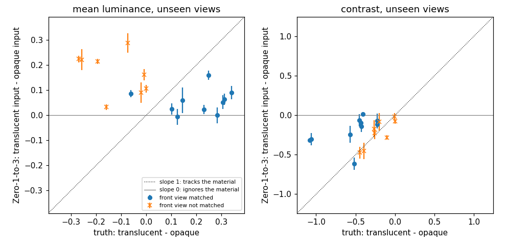
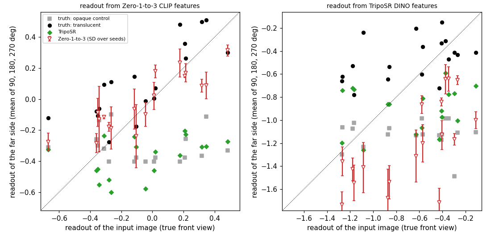
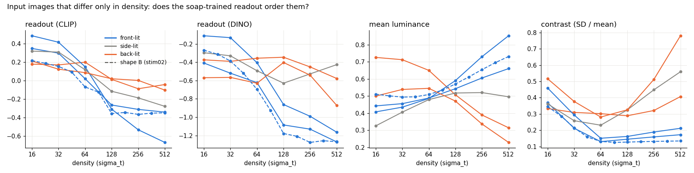
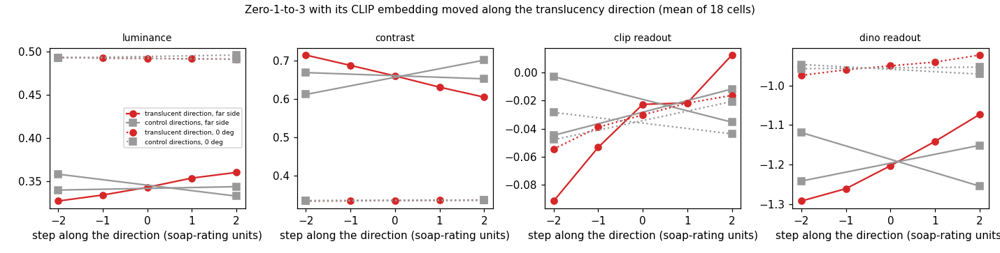
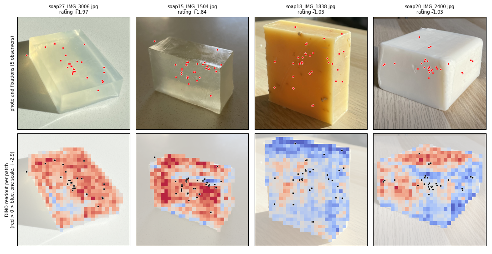

# Diffusion models and single-image 3D generation: do they keep translucency?

A learning repository with one experiment. Part 1 implements diffusion models from scratch (DDPM,
classifier-free guidance, DDIM). Part 2 asks a question from material perception: **when the input image shows a
translucent object, what do pretrained single-image-to-3D models put on the side they cannot see?** The answer is
checked against physically based renders of the true object and of an opaque control. Part 3 asks whether the
models' features carry human judgements of translucency. Everything ran on a Quadro M4000 (8 GB).

## Main findings

| Unseen views (90, 180, 270 degrees), 18 cells | Zero-1-to-3 | TripoSR |
|---|---|---|
| Higher contrast than the true translucent object | 18 / 18 | 11 / 18 |
| Darker than the true translucent object | 16 / 18 | 15 / 18 |

- **The generated far side is over-shaded.** Zero-1-to-3 always gives it more contrast than the real translucent
  object, and usually less light. It is not simply an opaque object: over all conditions it lies between the
  truth and the opaque control.
- **The far side follows the visible side.** With matched translucent and opaque inputs, the far side changes
  with the front view of the input, not with the true far side.
- **The information is in the encoder.** A linear readout of Zero-1-to-3's CLIP embedding predicts human
  translucency ratings of soap photos (r = 0.93), including the difference between two photos of the same soap
  (r = 0.60), where image statistics fail.
- **Used as a measure, the readout shows the copying.** The real object reads as more translucent from the far
  side than from the front; Zero-1-to-3's far side keeps the value of the front. On the rendered inputs, the
  readout falls with scattering density under every lighting, which no single image statistic does.
- **Pushing the embedding barely reaches the image.** Zero-1-to-3's CLIP embedding is moved along the
  translucency direction across the whole soap range. The far side gets slightly brighter and softer (17 of 18
  cells), but only about 2% of the push reaches the output, as for random directions. The images stay metal-like.
- **Gaze follows brightness.** Observers fixate the bright parts of the soap, not where the readout finds
  translucency.


*Front-lit studio, lowest scattering density. Columns are viewpoints; the leftmost is the input view. Rows: the
path-traced truth, the opaque control, Zero-1-to-3, TripoSR. The true object stays bright from behind because
light passes through it. Zero-1-to-3 turns it into a dark, metal-like object.*

## Part 1: diffusion from scratch

| File | Contents |
|---|---|
| `diffusion/ddpm.py` | Noise schedule, forward process, epsilon-prediction loss, ancestral and DDIM samplers, classifier-free guidance |
| `diffusion/unet.py` | Small U-Net (0.94 M parameters) with time embedding and optional class embedding |
| `diffusion/train_2d.py` | DDPM on a 2D spiral, with figures of the forward and reverse processes |
| `diffusion/train_mnist.py`, `diffusion/train_mnist_cfg.py` | Unconditional and class-conditional MNIST; guidance scales and step counts |

|  |  |
|---|---|
| Rows: guidance scale 0, 1, 3, 7. Columns: requested digit 0-9. Same initial noise in every row. | Rows: DDIM with 5, 10, 20, 50 steps, then DDPM with 1000 steps. Guidance scale 3. |

With guidance scale 1 several digits are malformed; with 3 and 7 all ten are readable. DDIM is close to
converged at 10 steps (0.1 s for 10 images, against 9.0 s for 1000 DDPM steps).

## Part 2: translucency in single-image 3D generation

A translucent object lets light through, so its far side can be bright. A model that sees one image has to invent
the far side: does it invent that of a translucent object or of an opaque one?

- **Inputs.** Path-traced stimuli from a perception experiment: two blob shapes with a glass surface and a
  scattering volume at three densities (16, 128, 512; higher is more turbid), lit by a studio map (two
  rotations) or sunlight (front, side, back). 18 cells.
- **Models.** Zero-1-to-3 XL (3 seeds, 50 DDIM steps, guidance 3), with the sampling loop written by hand on the
  pretrained weights, and TripoSR (rendered from its own radiance field).
- **Truth.** The camera in the original Blender scene orbits the object by 90, 180 and 270 degrees with the
  original render settings; the 0-degree render reproduces the stimulus.
- **Opaque control.** Same shape, lighting and surface, but no light enters the object. Its reflectance is set
  so that the front view has the stimulus's mean luminance.
- **Measure.** Mean luminance and contrast (SD / mean of linear luminance) inside the object, averaged over the
  three unseen views. The models guess the far-side shape wrongly, so pixels are not compared.

### Results

Distance to each reference (mean absolute difference over cells, luminance / contrast). The two references differ
from each other by 0.174 / 0.394.

| Lighting | Cells | Zero-1-to-3 to truth | Zero-1-to-3 to opaque | TripoSR to truth | TripoSR to opaque |
|---|---|---|---|---|---|
| Front | 9 | 0.116 / 0.278 | 0.116 / 0.275 | 0.210 / 0.184 | 0.062 / 0.445 |
| Side | 3 | 0.228 / 0.405 | 0.252 / 0.282 | 0.186 / 0.188 | 0.210 / 0.242 |
| Back | 6 | 0.132 / 0.191 | 0.267 / 0.134 | 0.120 / 0.162 | 0.196 / 0.165 |
| All | 18 | 0.140 / 0.270 | 0.189 / 0.229 | 0.176 / 0.177 | 0.131 / 0.318 |


*Each point is one cell; on the diagonal the model agrees with the reference on the horizontal axis. Error bars:
SD over 3 seeds.*

- **Zero-1-to-3 over-shades the unseen side**: contrast above the truth in 18 of 18 cells, luminance below it
  in 16. Seed variation is small (0.022 / 0.046).
- **Front-lit, it matches the opaque control; overall, it does not.** Over all cells it is closer to the truth
  in luminance (0.140 against 0.189). Under sunlight the opaque control casts hard shadows (contrast above 1.2)
  that the model does not draw.
- **Scattering density barely changes its far side** (front-lit studio: luminance 0.32 to 0.35, where the truth
  goes from 0.56 to 0.45).
- **Back light does not help.** Back-lit inputs show light coming through the object (no opaque reflectance
  reproduces their front view), yet the far side is too dark in 4 of 6 back-lit cells and too contrasty in all 6.
- **TripoSR** is darker than the truth in 15 of 18 cells; its blurry renders lower contrast whatever the material.

### Matched inputs: does the model tell the materials apart?

Zero-1-to-3 is given the translucent stimulus and the opaque control with the same front-view luminance (the 10
cells where this match is possible). The prediction, fixed before running, was that the far side would not change.

| Unseen views, 10 cells | Luminance | Contrast |
|---|---|---|
| Slope of the model's difference on the true difference | +0.21 | +0.35 |
| Mean absolute difference: truth / model / seeds alone | 0.215 / 0.057 / 0.026 | 0.541 / 0.199 / 0.060 |
| Model difference with the right sign | 7 / 10 | 9 / 10 |



- The prediction was wrong: the far side does change, above seed noise and mostly in the right direction, but by
  a fifth to a third of the true difference.
- The change follows the input. The far-side contrast difference correlates 0.79 with the difference between the
  two input images and 0.48 with the true far-side difference, which are themselves unrelated (0.05).

### Is the far side drawn as glossy?

Highlight cues from a gloss-perception project, on the 10 matched cells:

| Unseen views | Highlight coverage | Highlight contrast | Highlight edge sharpness |
|---|---|---|---|
| Truth, translucent | 0.084 | 0.40 | 0.135 |
| Truth, opaque | 0.099 | 0.68 | 0.076 |
| Model, translucent input | 0.183 | 0.54 | 0.076 |
| Model, opaque input | 0.194 | 0.60 | 0.058 |

The model's far side has twice the highlight coverage of the true translucent object whatever the input material.
Only edge sharpness follows the input, again as in the front views. The cues also respond to shading edges and
relief, and perceived gloss was not measured.

### Limits

- Two blob shapes, two environment maps, one surface finish.
- The stimuli use a 5-degree field of view (Zero-1-to-3 was trained at about 49) and a 7.2-degree elevation
  (TripoSR assumes 0).
- The models get the far-side shape wrong, and shape changes shading; the opaque control does not remove this.
- Generated object regions come from thresholding the white background, so highlights touching the outline can
  be cut.

## Part 3: do the models' features carry perceived translucency?

- **Data.** 122 photos of 61 soaps (two each, under different light) from the Translucent Image Dataset (Liao,
  Sawayama & Xiao, 2023, CC BY 4.0), rated for translucency on a 7-point scale by 6 observers in our lab, with
  eye tracking. Photos, ratings and gaze data are not in this repository.
- **Target.** Ratings standardised per observer and averaged per photo (split-half r = 0.95; ceiling about
  r = 0.99).
- **Features.** Zero-1-to-3's CLIP image embedding and U-Net activations; TripoSR's DINO tokens. Baselines: 14
  image statistics used in the lab (luminance, contrast, highlight and spectral measures) and mean colour.
  Object regions come from a background-removal network checked against hand-drawn contours (mean IoU 0.94).
- **Prediction.** Ridge regression with whole soaps held out. Confidence intervals resample soaps; chance (from
  permutations) is 0.14 to 0.23.

| Features | r, held-out soaps (95% CI) |
|---|---|
| Mean colour | 0.57 (0.42 to 0.69) |
| 14 image statistics | 0.69 (0.61 to 0.75) |
| Zero-1-to-3 CLIP embedding, object on white | 0.93 (0.91 to 0.95) |
| Zero-1-to-3 U-Net, object on white, three noise levels | 0.87 to 0.89 |
| TripoSR DINO tokens, photo | 0.86 (0.82 to 0.90) |

Translucency can be read out linearly from both models' features, far better than from the image statistics
(+0.26 for the best model features, 95% CI +0.18 to +0.35). Removing the background changes little.

### Same soap, two photos

Only 5% of the rating variance lies within soaps, so a feature that just recognises the kind of soap (clear bar,
milky bar) would already score well. The two photos of a soap differ in lighting: diffuse, or a strong side or
back light. The readouts above, trained across soaps, are applied to both photos of the held-out soap, and the
difference between their predictions is compared with the difference between the ratings. Observer agreement on
these differences puts the ceiling at r = 0.91.

| Features | r within soaps (95% CI) | Right direction, 29 large differences |
|---|---|---|
| Image statistics + colour | 0.01 (-0.23 to 0.26) | 14 |
| Zero-1-to-3 CLIP, object on white | 0.60 (0.36 to 0.76) | 24 |
| Zero-1-to-3 U-Net, high noise, object on white | 0.55 (0.31 to 0.73) | 24 |
| TripoSR DINO, photo | 0.48 (0.22 to 0.68) | 19 |

- **The model features carry more than the kind of soap.** The CLIP readout follows within-soap differences
  (p = 0.001) although it was trained only across soaps.
- **The image statistics do not.** Across soaps they mostly say that low contrast looks translucent (luminance SD
  r = -0.59 with the rating). Within a soap the sign flips (+0.24): a back-lit translucent soap glows with high
  contrast and is rated more translucent.
- **The effect rests on pairs with a clear difference** (split at the median, chosen after seeing the result).
  Among the 29 larger differences, CLIP gets 24 directions right and two halves of the observers agree on 90%.
  Among the 32 smaller ones, even the observer halves agree on only 41%.

### The readout as a translucency measure for the Part 2 images

The CLIP readout (object on white), fitted to all 122 soap photos, is applied to the Part 2 images; values are in
units of the soap ratings. A readout from TripoSR's DINO tokens is a second measure. As a check, the true
translucent far side scores above the opaque control in 18 of 18 cells with both measures (front views, matched
in luminance: 13 and 16 of 18).

| Mean over 18 cells | CLIP | DINO |
|---|---|---|
| Input (true front view) | -0.06 | -0.67 |
| True far side, translucent | +0.11 | -0.47 |
| True far side, opaque control | -0.31 | -1.12 |
| Zero-1-to-3, same view as the input | -0.03 | -0.95 |
| Zero-1-to-3, far side | -0.02 | -1.22 |



*Each point is one cell: readout of the input image (horizontal) against readout of the far side (vertical). On
the diagonal the far side scores the same as the front.*

- **The real object reads as more translucent from the far side**: +0.17 over the front with CLIP (higher in 15
  of 18 cells), +0.20 with DINO.
- **Zero-1-to-3's far side keeps the value of its input view** (+0.00 from its own 0-degree output; below the truth
  in 13 of 18 cells) but stays well above the opaque control. Across cells it follows the input (partial
  r = 0.66) more than the true far side (0.24).
- DINO, which Zero-1-to-3 never sees, agrees: the far side is 0.26 below the model's 0-degree output and below
  the truth in 18 of 18 cells, though DINO rates all generated images lower. For TripoSR the two measures
  disagree, so no conclusion is drawn.
- Because Zero-1-to-3 is conditioned on the CLIP embedding, staying close to the input in CLIP space is partly
  expected for any property.

### Does the readout follow density?

A check that the soap-trained readout measures material in the rendered stimuli, not only in soap photos. It is
applied to the 41 input images. Within each of the 6 cells, the images differ only in scattering density: 6 steps
from 16 to 512 for shape A, 11 for shape B. Expected before running: the higher the density, the lower the
readout.

| | CLIP readout | DINO readout | Mean luminance | Contrast |
|---|---|---|---|---|
| Rank correlation with density, range over the 6 cells | -0.77 to -1.00 | -0.09 to -1.00 | -1.00 to +1.00 | -0.55 to +0.60 |
| Share of variance from density (shape A, 5 cells) | 0.72 | 0.39 | 0.01 | 0.28 |
| Share of variance from the lighting cell | 0.04 | 0.26 | 0.17 | 0.42 |



- **The CLIP readout falls with density in all 6 cells.** It is in perfect rank order in 4 of them, and 30 of
  the 35 steps go down. Averaged over shape A, it drops from +0.31 at density 16 to -0.29 at 512, about two
  thirds of the SD of the soap ratings.
- **No single image statistic does this.** Mean luminance rises with density under front light and falls under
  back light, so its correlation with density flips sign with the lighting.
- **The lighting barely moves the readout** (4% of the variance), but density matters less under back light: the
  range is about 0.3 there, against 0.6 to 1.2 under front light. Observers also see back-lit objects as more
  translucent. Whether they show the same interaction needs a human experiment.

### Pushing the embedding toward translucency

If the CLIP embedding carries translucency, does Zero-1-to-3 use it? The embedding is moved along the
translucency direction, defined as the change in embedding per rating unit across the 122 soap photos. The input
latent and the noise stay fixed. Steps run from -2 to +2 rating units, and from end to end they span the whole
range of the soap photos along this direction. Two control directions of the same length come from shuffled
ratings. Step 0 reproduces the Part 2 images exactly. The prediction, written down before the run, was that the
far side would turn more translucent than under the controls.

| Far side, step +2 minus step -2, mean of 18 cells (cells that moved toward translucent) | Translucency | Control 1 | Control 2 |
|---|---|---|---|
| Luminance | +0.033 (17) | +0.004 (8) | -0.025 (4) |
| Contrast | -0.110 (17) | -0.016 (10) | +0.089 (0) |
| CLIP readout | +0.10 (16) | +0.03 (13) | -0.03 (5) |
| DINO readout | +0.22 (17) | +0.09 (14) | -0.14 (6) |



- **The direction is used, a little.** The far side gets brighter, lower in contrast and higher on both readouts
  in 16 or 17 of 18 cells. On average that is two to three times the change under the controls. The input view
  does not change.
- **Most of the push is lost.** The push moves the readout of the embedding by 3.6 rating units, but the output's
  CLIP readout moves by only 0.10. At +2 the far side closes about a quarter (CLIP) or a fifth (DINO) of the gap
  to the true translucent far side, and the images still look like metal (`steer_example.png`). Over the whole
  range, the contrast change is about two seed-to-seed SDs.
- **The loss applies to every direction.** About 2% of the push shows up in the output's own CLIP embedding
  along the pushed direction: 0.019 for translucency and 0.018 and 0.021 for the controls. The translucency
  direction still stands out: per cell it beats both controls in 7 to 11 of 18 cells, against about 3 if it were
  just another direction.
- **So the generator can use the information but barely listens to its CLIP embedding.** Even a push across the
  whole soap range closes only part of the gap. The far side is set mostly by the input latent and the model's
  prior, so a better encoder alone would not fix it.

### Where observers look

97% of fixations fall on the object, which is why summaries of how widely people look showed nothing. The
question here is where on the object they look. P003 fixated the object centre far more than the others (81% of
fixations near the centroid, against 30 to 58%) and is left out: 5 observers, a median of 36 fixations per
photo. Features are patch tokens of the photos (DINO 32 x 32, CLIP 16 x 16). The control is a typical gaze
layout: other soaps' fixations mapped onto this object's bounding box, with the same number of fixations.

| | DINO | CLIP |
|---|---|---|
| r, patches pooled uniformly over the object | 0.90 | 0.92 |
| r, pooled by this photo's gaze | 0.87 | 0.91 |
| r, pooled by the typical layout (median of 20 draws) | 0.85 | 0.91 |
| Luminance at fixations minus typical layout, SD (95% CI) | +0.26 (0.21 to 0.31) | +0.25 (0.20 to 0.30) |
| Readout at fixations minus typical layout, SD (95% CI) | +0.04 (-0.01 to +0.09) | +0.05 (+0.01 to +0.09) |



*Top: the two highest- and two lowest-rated photos with the fixations of 5 observers. Bottom: the DINO readout
per patch on one colour scale. The signal covers the whole object.*

- **Gaze adds nothing to the readout.** Pooling by gaze is no better than by the typical layout (95% CI of the
  difference -0.01 to +0.04 for DINO), and the parts nobody looked at carry as much as the whole object.
- **Gaze follows brightness.** Fixations land on brighter parts in about 4 of 5 photos, whatever the rating, and
  hardly go where the readout is high (a fifth of the brightness effect; absent for DINO).
- So the translucency information is spread over the object, and where people look does not change with
  translucency.

### Limits

- 61 soaps and 6 observers (5 for gaze). The within-soap result rests on about 30 pairs.
- The encoders are general-purpose and used as is, so this says nothing about what training for 3D added.
- The readout is trained on soap photos and applied to rendered blobs. It orders the rendered inputs by density,
  but whether observers see the generated far side as less translucent has not been measured.
- The steering test used one model, one seed and two control directions.

## Related work

From a short, non-exhaustive literature search (TRELLIS.2 read in full, the others from summaries):

- Recent image-to-3D models output albedo, roughness and metallic maps (for example Hunyuan3D 2.1), so there is no
  channel for light that passes through the object.
- TRELLIS.2 (Xiang et al., 2025) adds a per-voxel opacity in [0, 1] but models no scattering or refraction and
  reports no evaluation on translucent objects. It needs more GPU memory than was available here.
- Subsurface scattering is handled in multi-view reconstruction (SSS-3DGS, GTSR). DIAMOND-SSS fine-tunes diffusion
  models on translucent captures, which suggests that training data rather than architecture is missing.
- Marlow, Kim & Anderson (2017): perceived opacity depends on how intensity covaries with surface orientation,
  which needs an explicit 3D shape.

No study was found that compares the far side a single-image 3D model generates for a translucent object with a
physically based reference or with human judgements.

**What did not work:** Zero-1-to-3 did not produce coherent side views of a tall, thin wax statue (with an opaque
copy, rendered earlier), whatever the material. The scripts are kept in `image_to_3d/statue.py`; no result is
reported.

## Files

| File | Contents |
|---|---|
| `image_to_3d/common.py` | Conditions, input preparation, luminance statistics |
| `image_to_3d/render_gt_views.py`, `render_all_gt.py` | Blender: orbit the camera, render the truth and the opaque control |
| `image_to_3d/run_zero123.py`, `run_triposr.py` | Zero-1-to-3 sampling on the pretrained weights; TripoSR inference and rendering |
| `image_to_3d/analyze_all.py`, `analyze_pairs.py`, `analyze_gloss.py` | Part 2 tables and figures; matched pairs; highlight cues |
| `image_to_3d/translucency_readout.py` | The soap-trained readout applied to the Part 2 images |
| `image_to_3d/readout_density.py` | The readout on input images that differ only in density |
| `image_to_3d/steer_embedding.py` | Zero-1-to-3 with its CLIP embedding moved along the translucency direction |
| `soap/segment.py`, `soap/finalize.py` | Object regions for the soap photos |
| `soap/features.py`, `soap/predict.py`, `soap/ratings.py` | Features, rating loader, prediction of the ratings |
| `soap/within_pair.py` | Two photos of the same soap; image-statistic cues |
| `soap/patch_features.py`, `soap/gaze_model.py` | Patch features of the photos; gaze against the model features |

## Setup

```
python -m venv .venv
.venv\Scripts\pip install torch==2.7.1 torchvision==0.22.1 --index-url https://download.pytorch.org/whl/cu118 --extra-index-url https://pypi.org/simple
.venv\Scripts\pip install -r requirements.txt
```

Part 2 also needs the TripoSR code in `data/third_party/TripoSR`, Blender 4.5 and the stimulus scenes, which are
not in this repository. Model weights (`stabilityai/TripoSR`, `bennyguo/zero123-xl-diffusers`) are loaded from the
local Hugging Face cache; set `HF_HOME` to the folder that holds it. Peak GPU memory: 6.5 GB for Zero-1-to-3,
2.2 GB for TripoSR.
