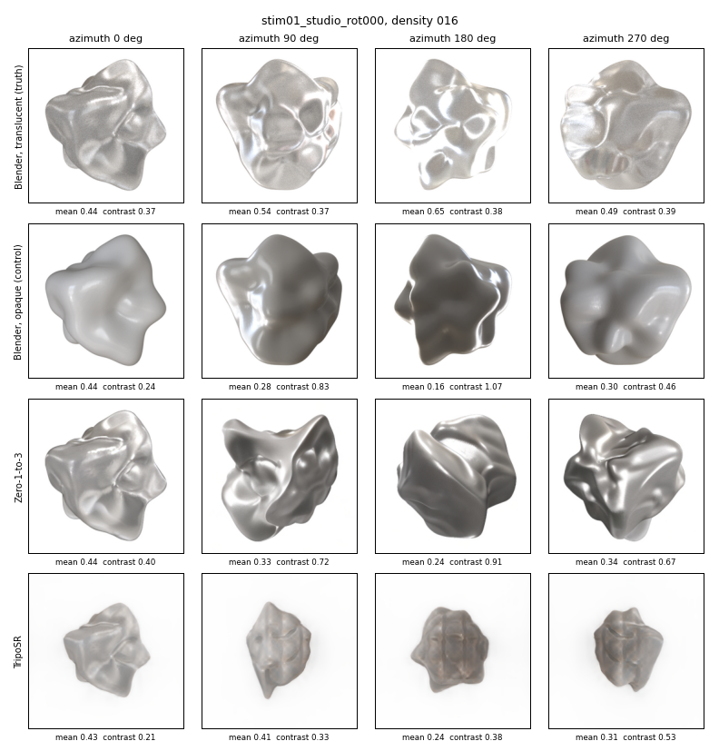
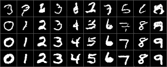
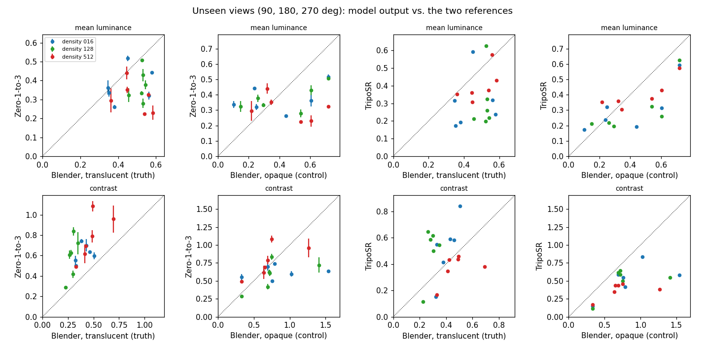
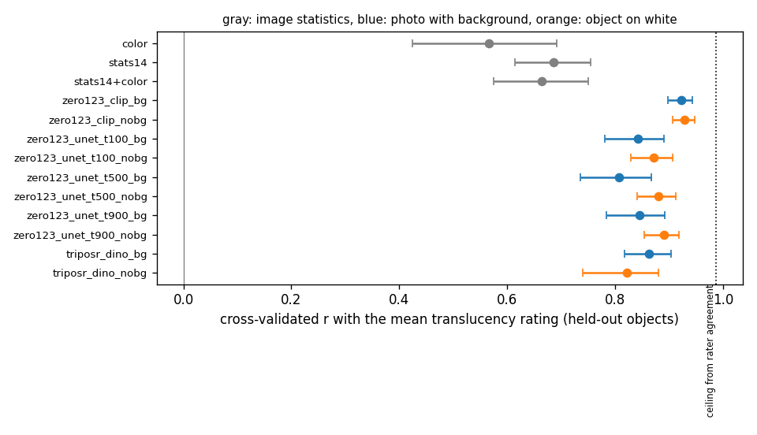

# Diffusion models and single-image 3D generation: do they keep translucency?

A learning repository with one experiment. The first half implements diffusion models from scratch
(DDPM, classifier-free guidance, DDIM). The second half takes two pretrained single-image-to-3D models and asks
a question from material perception: **when the input image shows a translucent object, what do these models
put on the side they cannot see?** The answer is checked against physically based renders of the true object
from the same viewpoints, and against an opaque control with the same shape and lighting.

Everything was run on a Quadro M4000 (8 GB, Maxwell generation).

## At a glance

- **Diffusion from scratch.** DDPM, class conditioning with classifier-free guidance, and a DDIM sampler, in
  about 300 lines of PyTorch. Trained on a 2D toy distribution and on MNIST.
- **Zero-1-to-3 sampling written by hand.** The conditioning (CLIP embedding + relative camera pose, input
  latent concatenated to the noisy latent) and the guidance loop are written directly on the pretrained
  weights, using the same pieces as the MNIST code.
- **An experiment with ground truth.** 6 shape-and-lighting conditions x 3 scattering densities. For each, the
  true novel views and an opaque control are path traced; Zero-1-to-3 (3 seeds) and TripoSR are run on the same
  input image.

| Result (unseen views: 90, 180, 270 degrees; 18 cells) | Zero-1-to-3 | TripoSR |
|---|---|---|
| Higher contrast than the true translucent object | 18 / 18 | 11 / 18 |
| Darker than the true translucent object | 16 / 18 | 15 / 18 |
| Front lighting: luminance / contrast distance to truth | 0.116 / 0.278 | 0.210 / 0.184 |
| Front lighting: luminance / contrast distance to opaque control | 0.116 / 0.275 | 0.062 / 0.445 |

**What holds:** on the unseen side, Zero-1-to-3 always produces stronger shading contrast than the real
translucent object, and usually a darker one. **What does not hold as stated:** the outputs do not simply match
an opaque object. That description fits the front-lit studio condition well, but over all conditions the
outputs sit between the two references. Given matched translucent and opaque inputs, the far side
changes a little, and the change follows the front view of the input rather than the true far side. Yet the
models' image encoders predict human translucency ratings of real photographs well (Part 3). Details and limits
are below.



*Front-lit studio, lowest scattering density. Columns are viewpoints; the leftmost is the input view. Row 1 is
the path-traced truth, row 2 the opaque control, rows 3 and 4 the models. The true object stays bright from
behind because light passes through it. Zero-1-to-3 turns it into a dark, metal-like object.*

## Part 1: diffusion from scratch

| File | Contents |
|---|---|
| `diffusion/ddpm.py` | Noise schedule, forward process, epsilon-prediction loss, ancestral sampler, DDIM sampler, classifier-free guidance |
| `diffusion/unet.py` | Small U-Net (0.94 M parameters) with time embedding and optional class embedding |
| `diffusion/train_2d.py` | DDPM on a 2D spiral, with figures of the forward and reverse processes |
| `diffusion/train_mnist.py` | Unconditional DDPM on MNIST |
| `diffusion/train_mnist_cfg.py` | Class-conditional MNIST with label dropout; compares guidance scales and step counts |

|  |  |
|---|---|
| Rows: guidance scale 0, 1, 3, 7. Columns: requested digit 0-9. Same initial noise in every row. | Rows: DDIM with 5, 10, 20, 50 steps, then DDPM with 1000 steps. Guidance scale 3. |

- With guidance scale 1 several digits are malformed; with 3 and 7 all ten are readable.
- DDIM is close to converged at 10 steps (0.1 s for 10 images, against 9.0 s for 1000 DDPM steps).
- Training: 15 epochs, about 16 minutes each for the unconditional and the conditional model.

## Part 2: translucency in single-image 3D generation

### Question

A translucent object lets light through, so its far side can be bright, and its thin parts glow when lit from
behind. A model that sees one image has to invent the far side. Does it invent the far side of a translucent
object, or of an opaque one?

### Setup

- **Inputs.** Existing path-traced stimuli from a perception experiment: two blob shapes with a glass surface
  and a homogeneous scattering volume. Scattering density takes three levels (16, 128, 512; higher is more
  turbid). Lighting is a studio environment map (two rotations) or a sunlit outdoor map (front, side and back
  lighting). 6 shape-and-lighting conditions x 3 densities = 18 cells.
- **Models.** Zero-1-to-3 XL (a view-conditioned diffusion model; 3 seeds, 50 DDIM steps, guidance 3) and
  TripoSR (a feed-forward reconstruction model, rendered from its own radiance field).
- **Truth.** The camera in the original Blender scene is orbited around the object by 90, 180 and 270 degrees.
  Object and lighting stay fixed. Same Cycles settings as the stimuli (256 bounces, no denoising), at 512 x 512
  and 512 samples. The 0-degree render reproduces the original stimulus (mean luminance within 0.03 in all 18
  cells).
- **Opaque control.** Same shape, lighting, surface roughness and index of refraction, but no light enters
  the object. Its reflectance is chosen per cell so that the front view has the same mean luminance as the
  translucent stimulus: "the opaque object that explains the front view".
- **Measure.** Mean luminance and contrast (standard deviation / mean of linear luminance) inside the object,
  averaged over the three unseen views. Pixelwise comparison is not meaningful because the models guess the
  far-side shape wrongly. Averaging over 90, 180 and 270 degrees also makes the result independent of which
  rotation direction a model calls positive.

### Results

Distance to each reference (mean absolute difference over cells, luminance / contrast):

| Lighting | Cells | Zero-1-to-3 to truth | Zero-1-to-3 to opaque | TripoSR to truth | TripoSR to opaque |
|---|---|---|---|---|---|
| Front | 9 | 0.116 / 0.278 | 0.116 / 0.275 | 0.210 / 0.184 | 0.062 / 0.445 |
| Side | 3 | 0.228 / 0.405 | 0.252 / 0.282 | 0.186 / 0.188 | 0.210 / 0.242 |
| Back | 6 | 0.132 / 0.191 | 0.267 / 0.134 | 0.120 / 0.162 | 0.196 / 0.165 |
| All | 18 | 0.140 / 0.270 | 0.189 / 0.229 | 0.176 / 0.177 | 0.131 / 0.318 |

For scale, the two references differ from each other by 0.174 / 0.394 on average.



*Each point is one cell. Points on the diagonal agree with the reference on the horizontal axis. Error bars
on Zero-1-to-3 are the standard deviation over 3 seeds.*

1. **Zero-1-to-3 over-shades the unseen side.** Its contrast is above the truth in all 18 cells and its mean
   luminance is below the truth in 16. The variation across seeds is small (0.022 / 0.046), so this is not
   sampling noise.
2. **In the front-lit studio condition the output matches the opaque control.** For the first shape the unseen
   views give 0.32 / 0.74, 0.33 / 0.63, 0.35 / 0.69 for the three densities, against 0.25 / 0.79, 0.29 / 0.72,
   0.35 / 0.65 for the opaque control and 0.56 / 0.38, 0.52 / 0.28, 0.45 / 0.42 for the truth.
3. **This does not generalise as "the model assumes an opaque object".** Over all cells Zero-1-to-3 is closer
   to the truth in luminance (0.140 against 0.189) and only slightly closer to the opaque control in contrast
   (0.229 against 0.270). Under sunlight the opaque control has hard cast shadows (contrast above 1.2) that
   the model does not produce.
4. **Scattering density barely changes what the model puts on the far side** in the front-lit studio condition
   (luminance 0.32 to 0.35 across densities, where the truth goes from 0.56 to 0.45).
5. **TripoSR is darker than the truth in 15 of 18 cells** but its contrast is mixed (higher in 11). Its renders
   are blurry, which lowers contrast regardless of material.

### Back lighting

With the light behind the object, the front of the translucent object is bright because light comes through
it. No opaque reflectance reproduces that: in 8 of the 18 cells (all back-lit cells and two side-lit ones) even
a reflectance of 0.9 leaves the opaque front view darker than the stimulus. In those cells the control uses
0.9 and its front view does not match. So the back-lit input images contain direct evidence that the object
transmits light. Zero-1-to-3 is still darker than the truth on the far side in 4 of the 6 back-lit cells and
higher in contrast in all 6.


### Does the model tell the two materials apart?

The comparison above shows that the output is wrong, not whether the model responds to the material at all. To
test that, Zero-1-to-3 is given pairs of inputs that differ only in material: the translucent stimulus, and the
opaque control with the same shape, lighting and front-view mean luminance. The measure was fixed before
running: regress, across cells, the difference between the two model outputs on the difference between the two
true far sides. A slope of 0 means the model ignores the material; 1 means it tracks it. The prediction was a
slope near 0. Only the 10 cells where the front views could be matched are a fair pair.

| Unseen views, 10 matched cells | Luminance | Contrast |
|---|---|---|
| Slope (model difference on true difference) | +0.21 | +0.35 |
| Mean absolute true difference | 0.215 | 0.541 |
| Mean absolute model difference | 0.057 | 0.199 |
| Difference expected from seeds alone | 0.026 | 0.060 |
| Cells where the model difference has the right sign | 7 / 10 | 9 / 10 |


**The prediction was wrong: the two inputs do not give the same far side.** The difference is above seed noise
and mostly has the sign of the true difference, but it is a fifth to a third of its size.


**The difference follows the front view of the input, not the true far side.** Across the 10 cells, the model's
far-side contrast difference correlates 0.79 with the contrast difference between the two input images, and
0.48 with the true far-side difference; the input difference and the true far-side difference are themselves
unrelated (0.05). So the model carries the shading of the visible side over to the hidden side, and the
agreement in sign with the truth is largely a by-product. Mean luminance is not explained this way: the two
inputs were matched in front luminance (largest difference 0.019), yet the far side is 0.057 brighter for the
translucent input. Ten cells, one of them with a much larger contrast difference than the rest.

### Is the far side drawn as a glossy object?

In the example above the translucent input becomes a metal-like object. Highlight cues from a separate project
on gloss perception (highlight region = where a multi-scale centre-surround response exceeds a threshold fixed
on a rated gloss dataset) were applied to the same images.

| Unseen views, 10 matched cells | Highlight coverage | Highlight contrast | Highlight edge sharpness |
|---|---|---|---|
| Truth, translucent | 0.084 | 0.40 | 0.135 |
| Truth, opaque | 0.099 | 0.68 | 0.076 |
| Model, translucent input | 0.183 | 0.54 | 0.076 |
| Model, opaque input | 0.194 | 0.60 | 0.058 |

- The model's far side has about twice the highlight coverage of the true translucent object (larger in 9 of
  10 cells) and higher highlight contrast (10 of 10).
- This is not specific to translucent inputs: the opaque input gives the same coverage and contrast. The far
  side is drawn highlight-rich whatever the material.
- The input changes only the edge sharpness (sharper for the translucent input in 10 of 10), which again
  matches the front views (0.134 against 0.086).
- These cues also respond to shading edges and fine relief, and the generated shapes are more convoluted than
  the true ones. Perceived gloss was not measured.

### Limits

- Two shapes, two environment maps, one surface finish. Both shapes are irregular blobs.
- The stimuli were rendered with a 5-degree field of view. Zero-1-to-3 was trained at about 49 degrees, so
  part of the error may come from this mismatch rather than from the material.
- The models get the far-side shape wrong, and shape changes shading. The opaque control shows what an opaque
  object of the true shape looks like; it does not remove the shape difference in the model output.
- The object region of generated images is found by thresholding the white background, so highlights that
  touch the outline can be cut. Blender images use the alpha channel.
- Luminance statistics are a proxy. Whether observers see the generated views as translucent has not been
  measured.
- TripoSR assumes the input is at zero elevation; the stimuli are at 7.2 degrees.

### Files

| File | Contents |
|---|---|
| `image_to_3d/common.py` | Conditions, input preparation, luminance statistics |
| `image_to_3d/render_gt_views.py` | Blender script: orbit the camera, render the translucent truth or the opaque control |
| `image_to_3d/render_all_gt.py` | Runs the Blender script for every condition and picks the control reflectance |
| `image_to_3d/run_zero123.py` | Zero-1-to-3 sampling written on the pretrained weights |
| `image_to_3d/run_triposr.py` | TripoSR inference and novel-view rendering |
| `image_to_3d/analyze_all.py` | Tables, `figures/summary.json`, and the comparison figures |
| `image_to_3d/analyze_pairs.py` | The matched-pair test: translucent input against opaque input |
| `image_to_3d/analyze_gloss.py` | Highlight cues of true and generated far sides (uses a separate gloss project) |
| `soap/segment.py`, `soap/finalize.py` | Object regions for the soap photographs |
| `soap/features.py`, `soap/predict.py` | Model features and image statistics; prediction of the ratings |

Peak GPU memory: 6.5 GB for Zero-1-to-3 (4 views with guidance), 2.2 GB for TripoSR.

## Part 3: do the models' features carry perceived translucency?

Part 2 looks at outputs. This part asks whether the information is present inside the models at all.

- **Data.** 122 photographs of 61 soaps (two photos each) from the Translucent Image Dataset (Liao, Sawayama &
  Xiao, 2023, CC BY 4.0), with translucency ratings on a 7-point scale from 6 observers collected in our lab.
  Photographs and ratings are not in this repository.
- **Target.** Ratings standardised per observer and averaged per photo. Split-half correlation between
  observers is 0.95, so a perfect predictor would reach about r = 0.99.
- **Object regions.** A background-removal network, checked against 61 hand-drawn contours (mean IoU 0.936);
  four photos where it included the cast shadow were corrected by hand or with a second network, one is left.
- **Features.** Zero-1-to-3: its CLIP image embedding, and U-Net activations (mid block and two up blocks,
  averaged inside the object) when the photo is the conditioning image and its own noised latent is the input,
  at three noise levels. TripoSR: its DINO image tokens. Baselines: 14 image statistics used in the lab
  (luminance, contrast, highlight and spectral measures) and mean colour.
- **Prediction.** Ridge regression, leaving one soap out at a time so that both photos of a soap are always
  held out together. Confidence intervals resample soaps; chance is from 200 permutations of ratings over soaps.

| Features | Dimensions | r, held-out soaps | 95% CI |
|---|---|---|---|
| Mean colour | 6 | 0.57 | 0.42 to 0.69 |
| 14 image statistics | 14 | 0.69 | 0.61 to 0.75 |
| Image statistics + colour | 20 | 0.66 | 0.57 to 0.75 |
| Zero-1-to-3 CLIP embedding (photo / object on white) | 768 | 0.92 / 0.93 | 0.90 to 0.95 |
| Zero-1-to-3 U-Net, low / medium / high noise (object on white) | 3200 | 0.87 / 0.88 / 0.89 | 0.83 to 0.92 |
| Zero-1-to-3 U-Net, low / medium / high noise (photo) | 3200 | 0.84 / 0.81 / 0.85 | 0.74 to 0.89 |
| TripoSR DINO tokens (photo / object on white) | 768 | 0.86 / 0.82 | 0.74 to 0.90 |

Chance level (95th percentile of permutations) is 0.14 to 0.23 for every row.



- **Perceived translucency can be read out linearly from both models' features**, far better than from the
  image statistics (+0.26 for the best model features over statistics + colour, 95% CI +0.18 to +0.35).
- Removing the background changes little, so the prediction does not rest on shadows or light cast on the table.
- Together with Part 2: the information that separates translucent from opaque is available to the model, but
  the generated far side does not use it to change how light behaves. The failure is in what is rendered, not
  in what is encoded.

Limits: 61 objects and 6 observers. The embedding is a general-purpose image encoder used as is, so this says
nothing about what training for 3D added. The U-Net receives the image itself, so high decodability there is
expected. Soaps come in types (clear glycerine bars, milky bars), and a feature that recognises the type would
also predict the rating; held-out soaps rule out memorising an object, not this. Decodable does not mean used.

## Related work and what is still open

From a short literature search (summaries of the papers, except TRELLIS.2, which was read in full):

- Recent image-to-3D models output albedo, roughness and metallic maps (for example Hunyuan3D 2.1). There is
  no channel for light that passes through the object, so translucency has nowhere to go even if it is detected.
- TRELLIS.2 (Xiang et al., 2025) adds a per-voxel opacity and states that it can handle translucent surfaces.
  The paper defines opacity only as a value in [0, 1], models no scattering, transmission or refraction, gives
  no evaluation specific to translucent objects, and lists no limitation about materials. It needs far more
  GPU memory than was available here, so it was not run.
- Subsurface scattering is handled on the reconstruction side, from many views of one object (SSS-3DGS, GTSR).
  DIAMOND-SSS fine-tunes view-synthesis and relighting diffusion models on translucent captures, which suggests
  that the missing ingredient is training data rather than architecture.
- Marlow, Kim & Anderson (2017) argue that perceived opacity depends on how intensity covaries with surface
  orientation, computed where 3D shape is explicit. A model that maps image to image without an explicit shape
  or light has no place to do this for the unseen side.

No study was found that measures what a single-image 3D model puts on the far side of a translucent object
against a physically based reference, or that relates it to human judgements. The search was not exhaustive.

## What did not work

A multi-view set of a wax statue and an opaque copy (rendered earlier with another renderer) looked ideal: same
shape and light, true novel views already available. Zero-1-to-3 did not produce coherent side views of the
tall, thin statue (duplicated or fragmented figures at 90 and 270 degrees, with either material), and the
higher-resolution wax images were not denoised. The scripts are kept (`image_to_3d/statue.py`); no result
from this set is reported.

## Setup

```
python -m venv .venv
.venv\Scripts\pip install torch==2.7.1 torchvision==0.22.1 --index-url https://download.pytorch.org/whl/cu118 --extra-index-url https://pypi.org/simple
.venv\Scripts\pip install -r requirements.txt
```

Part 2 also needs the TripoSR code in `data/third_party/TripoSR`, the model weights from Hugging Face
(`stabilityai/TripoSR`, `bennyguo/zero123-xl-diffusers`), Blender 4.5, and the stimulus scenes, which are not
part of this repository.
